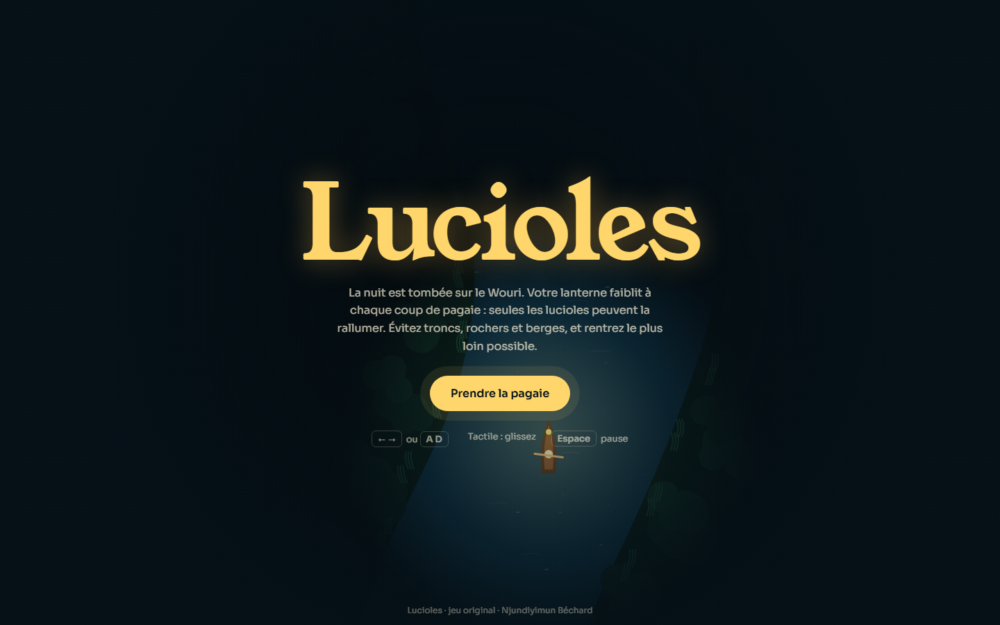
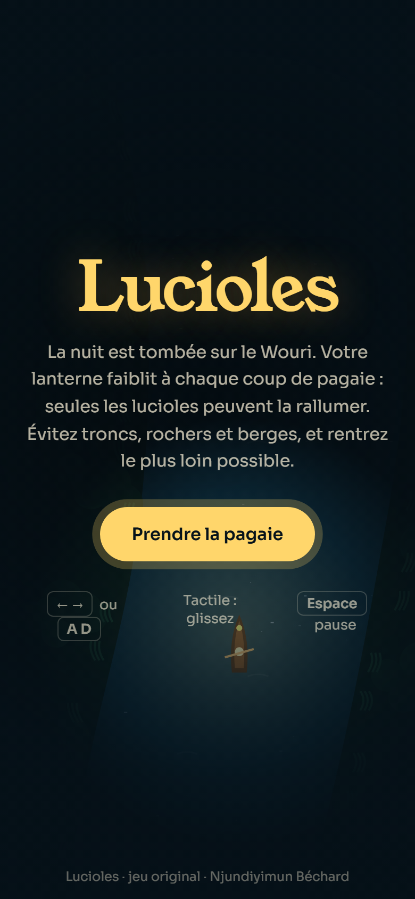

# Lucioles

**Jeu HTML5 original (Canvas)** — Jeu d'arcade original jouable dans le navigateur : guider une pirogue sur un fleuve nocturne généré à l'infini, où la lumière de la lanterne est à la fois la vie et le champ de vision. Graphismes et sons entièrement générés par le code.

**Démo en ligne : [https://lordlennyx.github.io/lucioles-jeu/](https://lordlennyx.github.io/lucioles-jeu/)**

Spot de présentation (30 s) : [media/spot-30s.mp4](https://lordlennyx.github.io/lucioles-jeu/media/spot-30s.mp4)

## Ce que le projet montre

- Mécanique originale : la lanterne faiblit avec le temps, les chocs la diminuent, les lucioles la rallument ; moins de lumière, moins de visibilité
- Fleuve procédural infini (bruit lissé), berges, roseaux, reflets d'étoiles, sillage, particules
- Obstacles variés : troncs dérivants, rochers, crocodiles en patrouille ; difficulté progressive
- Combos d'essaim sur une gamme pentatonique, ambiance d'eau et de grillons synthétisée (Web Audio, aucun fichier)
- Clavier, tactile, vibration mobile, pause automatique, record local, écran adaptatif haute densité

## Réalisation

- **Stack :** JavaScript natif, Canvas 2D, Web Audio API
- **Poids :** un seul fichier HTML d'environ 20 Ko
- **Évolutions possibles :** classement en ligne, niveaux, version PWA hors ligne, monétisation publicitaire

| Bureau | Mobile |
|---|---|
|  |  |

---

Client et contenus fictifs, créés pour la démonstration. Conception, design et développement : **Njundiyimun Béchard** — [github.com/LordLennyx](https://github.com/LordLennyx)
